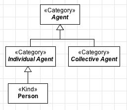
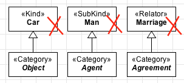
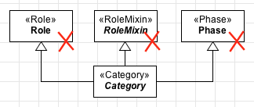

Constraints
-----------

.. _category-constraints-c1:
**C1:** A «:ref:`category`» is always abstract. Notice that abstract classes are represented with an *italic* label.

.. container:: figure

   |Category application 1|

.. _category-constraints-c2:
**C2:** A «:ref:`category`» aggregate individuals that follow :ref:`different identity principles <identity>`, therefore it may not have a sortal type as ancestor. «:ref:`kind`», «:ref:`collective`», «:ref:`quantity`», «:ref:`relator`», «:ref:`quality`», «:ref:`intrinsicMode`», «:ref:`extrinsicMode`», «:ref:`event`», «:ref:`situation`», «:ref:`type`», «:ref:`subkind`», «:ref:`role`», «:ref:`historicalRole`», and «:ref:`phase`» are all forbidden. 

.. container:: figure

   |Category forbidden 1|

.. _category-constraints-c3:
**C3:** A «:ref:`category`» is a :ref:`rigid <rigidity>` construct, therefore it cannot have as ancestor an :ref:`anti-rigid <rigidity>` type, as: «:ref:`role`», «:ref:`historicalRole`», «:ref:`phase`», «:ref:`rolemixin`», «:ref:`historicalRoleMixin`», and «:ref:`phasemixin`».

.. container:: figure

   |Category forbidden 2|

