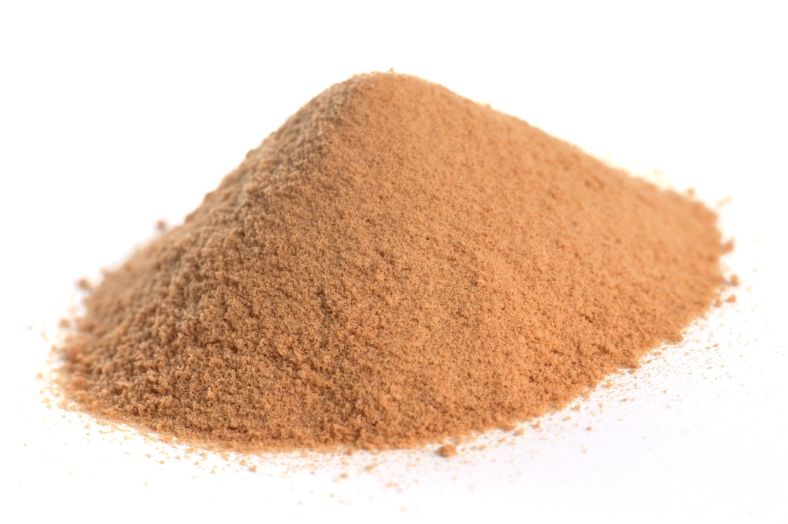

Definition
----------

A «:ref:`quantity`» is a :ref:`first-order ultimate sortal <ultimate-sortal>` whose instances are maximal portions of matter or stuff, unified by topological connectedness. Amount of Water, Lump of Clay, and Pile of Sand are quantities.

Quantities are homeomerous: their parts are portions of the same kind of matter as the whole. Dividing an amount of sand yields amounts of sand. Dividing a portion of water yields portions of water. The parts are not identical to the original whole. They fall under the same matter-kind. Because a quantity is maximal, it cannot have a quantity of the same kind as a part. A portion of wine is not composed of other portions of wine. The alcohol in the wine is a quantity of a different kind. See :ref:`subQuantity <subQuantityOf>`.

A practical test: if you physically divide an instance of *x* in two, and each result is a new instance of *x*, and the same remains true after further divisions, then *x* is a quantity.

.. figure:: /specification-figures/quantity.svg
   :alt: Amount of water, lump of clay, and pile of sand as quantities
   :width: 80%
   :align: center

   Classes categorized as «quantity».

A quantity may specialize a :ref:`category` or a :ref:`mixin`. It may be specialized by a :ref:`subkind`, :ref:`role`, :ref:`historicalRole`, or :ref:`phase`. Keep quantity apart from :ref:`quality`: a quantity is a portion of matter, and a quality is a measurable aspect of some bearer.

``restrictedTo`` is exactly ``{quantity}`` and ``order`` is 1.

   A heap of matter is a quantity when every division of it is more of the same matter.
