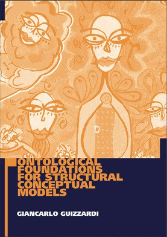

.. _ufo:

UFO
===

The **Unified Foundational Ontology** (UFO), developed by Giancarlo Guizzardi and colleagues, is the ontological theory behind :ref:`ontouml`. It brings together developments from GFO, DOLCE, and the ontology of universals used by OntoClean. UFO is specified as ISO/IEC 21838-5. OntoUML does not standardize UFO. It makes selected UFO distinctions available as a UML profile.

UFO distinguishes individuals from types, and then distinguishes concrete individuals by how they relate to time. Endurants exist in time and can change while keeping their identity. Events occur in time by accumulating temporal parts. Situations obtain at a time: they are configurations of a part of reality. Types, although they are not individuals, are themselves endurants: they exist in time, can bear qualities, and can change while remaining the same type. That is what makes multi-level classification possible inside the same theory.

The endurant fragment, often called UFO-A, was characterized in Giancarlo Guizzardi's thesis and extended at the Ontology and Conceptual Modeling Research Group (NEMO) in Brazil, with collaborators from Brandenburg University of Technology and the Laboratory for Applied Ontology. Later work added an ontology of events (UFO-B) and an ontology of social and intentional entities (UFO-C), and a commitment-based account of services (UFO-S). The same foundations have been used to analyze and redesign reference models in enterprise modeling, software engineering, service science, petroleum and gas, telecommunications, and bioinformatics.

This documentation summarizes the distinctions that the OntoUML profile actually uses. The summary is in :ref:`theory`. It is a guide to the language, and it is deliberately shorter than the full UFO literature.

|Book OFSCM|

