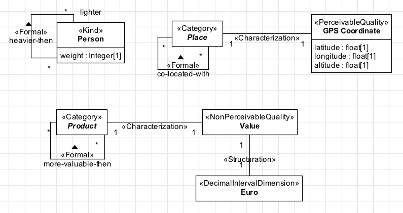

Definition
----------

«:ref:`comparative`» holds between entities compared through their qualities. There is no mediating relator. *heavierThan* compares weights. *tallerThan* compares heights. *olderThan* compares ages. *moreValuableThan* compares value ascriptions. *sameAgeAs* holds when two age values coincide. The relation between the quality values themselves can be any internal comparison, not only an ordering.

.. figure:: /specification-figures/comparative.svg
   :alt: heavierThan derived from the weight qualities of two persons
   :width: 85%
   :align: center

   Associations categorized as «comparative».

Each end is a class of concrete individuals. ``restrictedTo`` is a non-empty subset of the concrete individual natures.

A comparative association is derived from the intrinsic qualities that ground the comparison. The association is connected by a dependency to that quality type, and a derivation rule states the condition on the values. For example, *heavierThan* is derived from Weight, and it holds between two persons whenever the weight value of the first is greater than the weight value of the second.

An OCL sketch of that rule::

   context Person::heavierThan : Set(Person)
   derive : Person.allInstances()->select(x | self.weight > x.weight)

Make sure the relation really is a comparison of quality values. A relation made true by a relator or an extrinsic mode is :ref:`material`.

   Earlier examples, drawn when this stereotype was called «formal».
