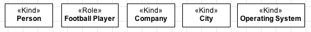
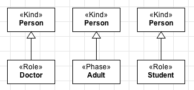

.. _individuals:

Types and Individuals
=====================

OntoUML is built upon the fundamental distinction between **types** and **individuals**.

**Individuals** are particulars, such as Ada Lovelace, the United Nations, Paris, or the marriage between John Lennon and Yoko Ono. **Types** are general entities: patterns of features that can be repeated across many entities, whether individuals or other types. Person, Organization, Marriage, Weight, Presidential Election, and Species are types. Individuals and types are disjoint. A type may have instances. An individual cannot.

Types are endurants in their own right. They exist in time and can change while remaining the same type. That is why a model can classify types as well as individuals. See :ref:`types-as-endurants`.

Let's consider the type Person. Which characteristics does every Person have? We could say a head, a heart, arms, hands, legs, feet, eyes... Every person also has a weight, a height, an age. Maybe a name, place of birth, birthdate.

Now let's consider you and me. I am individual. And so are you. If you are reading this, I am confident to say that we are both people. We both have a heart, we both have a particular height and weight. We *exemplify* what it is to be a Person. The relation that holds between us and the type Person is called **instantiation**.

In OntoUML, we represent classes as boxes, just like in UML. Every class must have a name and a stereotype, as depicted in the figure below:

.. container:: figure

   |Examples of types|

Now, let's see some other examples of types and individuals them:

-  **Person**: Bill Gates, Linus Torvalds, Barack Obama, Steve Jobs,
   Alan Turing, Messi
-  **Football Player**: Neymar, Messi, Cristiano Ronaldo, Pelé, Maradona
-  **City**: Rio de Janeiro, Milano, Barcelona, New York City, London,
   Lisbon
-  **Operating System**: Windows, OS X, Ubuntu
-  **Company**: Apple, Samsung, Microsoft, Facebook, Nokia

If you pay close attention to the list, you will see that we've included Messi's name as an instance of Person and Football Player. And that is fine! In fact, it very common that an individual simultaneously instantiates many types. Me, for example, besides being a Person, I'm a Software Developer, a Brazilian, an Adult and a Man.

The **extension** of a type is the collection of entities that instantiate it in a given circumstance. The extension can vary: entities come into existence, cease to exist, or start and stop instantiating the type. As an example, let's assume that the type Web Browser. Last year, we could say that its extension contained 5 individuals: Chrome, Internet Explorer, Safari, Firefox, Opera. This year, however, after Microsoft Edge's release, the extension of Browser grew by 1.

The same individual may instantiate several types at once and across time. In 1895 Marie Curie was a person, a scientist, and a wife. In 1911 she was still a person and a scientist, she was a widow rather than a wife, and she was a Nobel laureate.

Whenever every instance of one type is necessarily an instance of another, the former **specializes** the latter and inherits its characteristics and constraints. A type may specialize more than one supertype. Specializations of one type may also be organized along orthogonal criteria: Person may be specialized by life phase and, independently, by occupation, so that the same person is an adult and an employee at the same time. To represent specialization in OntoUML we use the UML **generalization** relation. Examples:

-  Doctor, Student and Child are subtypes of Person
-  Table, Mouse and Ball are subtypes of Object
-  Fridge, Stove and Microwave are subtypes of Appliance

We represent generalizations are lines with arrow heads on the end connected to the super-type, as shown in the figure below:

.. container:: figure

   |Generalization|

When we build a model in OntoUML we are formally defining types by specifying the characteristics they impose on their instances.

.. note::

   An OntoUML class diagram specifies types. Particular individuals are not boxes in that diagram. What the diagram can record, when the domain needs it, is that instances of one type instantiate instances of a higher-order type. That link is an :ref:`instantiation` association. See :ref:`multilevel`.

Concrete individuals are either endurants, events, or situations. Endurants exist in time, events occur in time, and situations obtain at a time. Abstract individuals, such as sets, numbers, and logical expressions, do not exist in space-time. They are used as values of qualities, and they are not given an endurant class stereotype of their own in the current profile. The three concrete categories are introduced in :ref:`endurants`, :ref:`events-theory`, and :ref:`situations-theory`.

