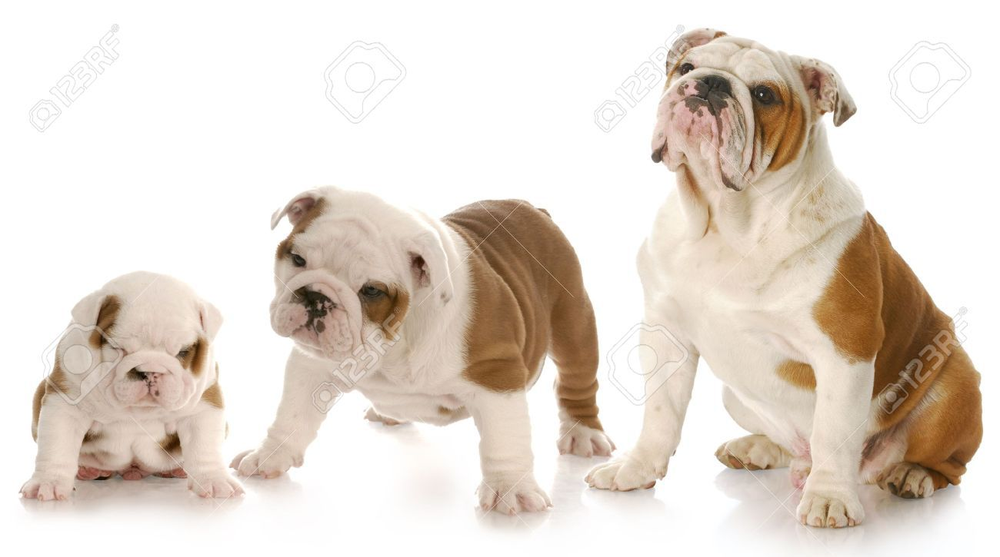
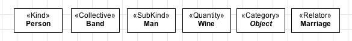
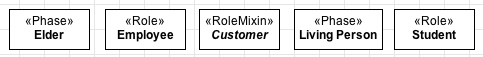

.. _rigidity:

Rigidity
========

Now that you are already familiar with the notion of type, individual and instantiation, let's go through a fundamental ontological meta-property of types - rigidity. To start, let's take a look at the following pictures:

|Dog phases|

They show a dog's development through the years (let's call him Rex for now). In the first frame (and maybe also in the second) Rex is a Puppy. In the third one he is not a Puppy anymore, but an Adult. However, in all three frames Rex is a Dog and a French Bulldog. Let's focus on the types Dog and French Bulldog. Can you imagine any other point in time, besides the three shown in the pictures, in which Rex ceased to be either a Dog or a Bulldog? I guess not. Let's expand our imagination a little. Can you imagine any individual that used to be a Dog but is not anymore? I bet the answer is also no.

If an individual must instantiate a given type in all possible scenarios in which the individual exists, we call that type **rigid**. Rigidity is about whether the classification is essential, not about how long it happens to last. Person is rigid because there is no way for a person to exist as the same individual and cease to be a person. Other rigid types include Marriage, Physical Object, and Species. Rigid stereotypes: «:ref:`kind`», «:ref:`collective`», «:ref:`quantity`», «:ref:`relator`», «:ref:`intrinsicMode`», «:ref:`extrinsicMode`», «:ref:`quality`», «:ref:`event`», «:ref:`situation`», «:ref:`type`», «:ref:`subkind`», and «:ref:`category`».

.. container:: figure

   |Rigid examples|

Now, let's focus solely on the type Puppy. By looking at the pictures, we can see that Rex used to be a puppy, but stopped being one after he grew older. Just like Rex, every other dog was once a puppy or will cease to be one someday. If every individual that instantiates a given type can cease to do so and still exist, then we call that type **anti-rigid**. Teenager applies because of an age value, and the same person ceases to be a teenager when that value leaves the interval. Employee applies because of an employment, and the same person ceases to be an employee when the employment ends. Anti-rigid stereotypes: «:ref:`role`», «:ref:`phase`», «:ref:`historicalRole`», «:ref:`rolemixin`», «:ref:`phasemixin`», and «:ref:`historicalRoleMixin`».

.. container:: figure

   |AntiRigid examples|

A **semi-rigid** type is essential to some of its instances and accidental to others. Music Artist can be essential to a band and accidental to a person who may abandon a musical career. Insurable Item can be essential to every car and every house, and accidental to a personal item that is insurable only while it is worth more than a given amount. The semi-rigid stereotype is «:ref:`mixin`».

